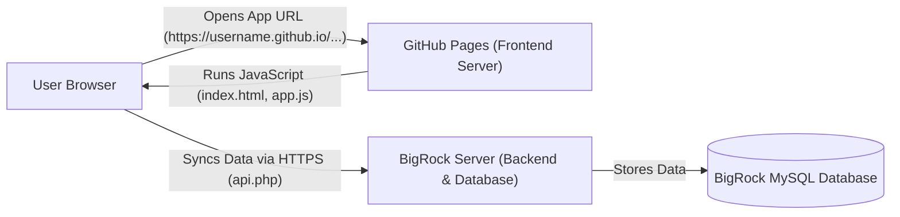

# 🚀 Guide: Host on GitHub Pages with BigRock Cloud MySQL Database

This guide explains how to host your application on **GitHub Pages** (your public web URL) while storing and syncing all client data, ledgers, and transactions in your **BigRock MySQL Database**.

---

## 🏗️ Architecture Overview



* **Frontend Web Server**: **GitHub Pages** provides the public URL to open the app (Free HTTPS: `https://yourusername.github.io/clientledger/`).
* **Cloud Database & Backend**: **BigRock** hosts the MySQL database and [`api.php`](file:///d:/BRT%20Application/Rahul%202.0/api.php).

---

## 🟢 PART 1: Set Up MySQL Database on BigRock

1. Log in to your **BigRock Account** and open **cPanel**.
2. Under the **Databases** section, click on **MySQL® Database Wizard**:
   * **Step 1: Create Database**: Enter a name, e.g. `ledgerdb` (Full name: `username_ledgerdb`).
   * **Step 2: Create User**: Enter a username, e.g. `dbuser` (Full name: `username_dbuser`) and set a strong password.
   * ⚠️ **Write down the Database Name, Username, and Password!**
   * **Step 3: Privileges**: Check the box for **ALL PRIVILEGES** and click **Make Changes**.

---

## 🔵 PART 2: Upload `api.php` to BigRock

1. Open [`api.php`](file:///d:/BRT%20Application/Rahul%202.0/api.php) on your computer and insert your BigRock database credentials (lines 20-23):
   ```php
   $DB_HOST = 'localhost';               // Keep 'localhost' on BigRock
   $DB_NAME = 'username_ledgerdb';       // Your BigRock Database Name
   $DB_USER = 'username_dbuser';         // Your BigRock Database Username
   $DB_PASS = 'YourStrongPassword123#';  // Your BigRock Database Password
   ```
2. In BigRock **cPanel**, open **File Manager**.
3. Open the **`public_html`** folder.
4. Click **Upload** and upload only `api.php` (or into a subfolder like `public_html/api.php`).
5. **Verify `api.php` is online**:
   Open in your browser: `https://yourdomain.com/api.php?action=ping`
   * You should see:
     ```json
     {"success":true,"message":"Successfully connected to BigRock MySQL database!"}
     ```
   * ⚠️ *Important*: Ensure your BigRock domain has SSL enabled (`https://`). BigRock provides free AutoSSL/Let's Encrypt in cPanel.

---

## 🟡 PART 3: Push Files to GitHub & Enable GitHub Pages

### Step 1: Pre-configure your BigRock URL in `app.js` (Optional but Recommended)
Open [`app.js`](file:///d:/BRT%20Application/Rahul%202.0/app.js#L9-L10) and set `DEFAULT_BIGROCK_API_URL`:
```javascript
const DEFAULT_BIGROCK_API_URL = 'https://yourdomain.com/api.php';
```
*(If you leave it blank, you can also set it anytime inside the application popup!)*

### Step 2: Push Code to GitHub
Open PowerShell or Command Prompt in `D:\BRT Application\Rahul 2.0` and run:

```bash
# 1. Initialize git (if not already done)
git init

# 2. Add files
git add .

# 3. Commit
git commit -m "ClientLedger Pro with GitHub Pages + BigRock MySQL Cloud Sync"

# 4. Set branch to main
git branch -M main

# 5. Link your GitHub repository
git remote add origin https://github.com/your-username/clientledger.git

# 6. Push
git push -u origin main
```

### Step 3: Turn on GitHub Pages
1. Go to your repository on [github.com](https://github.com).
2. Click **Settings** (tab on the top right).
3. In the left navigation menu, click **Pages**.
4. Under **Build and deployment** -> **Branch**:
   * Select `main` branch.
   * Leave folder as `/(root)`.
   * Click **Save**.
5. Wait 30-60 seconds and refresh the page. GitHub will show your live link:
   **`https://your-username.github.io/clientledger/`**

---

## 🟣 PART 4: Open Your Application & Connect

1. Open your GitHub URL in any browser:
   **`https://your-username.github.io/clientledger/`**
2. Log in with your credentials:
   * **Login ID**: `rahul`
   * **Password**: `1990`
3. Look at the top bar indicator:
   * If already configured in `app.js`, it will immediately pulse green: **`BigRock Cloud Synced 🟢`**.
   * If it shows **`Local Mode`**, click the **`Local Mode`** button (or go to **Settings ⚙️ -> BigRock Cloud Database**):
     * Enter your BigRock API URL: `https://yourdomain.com/api.php`
     * Click **⚡ Test Connection** (shows `✅ Connected! BigRock MySQL is active`).
     * Click **Save & Connect**.
4. That's it! Any client created or payment recorded via your GitHub link is now saved live in your **BigRock MySQL Database** and synced across all devices!
